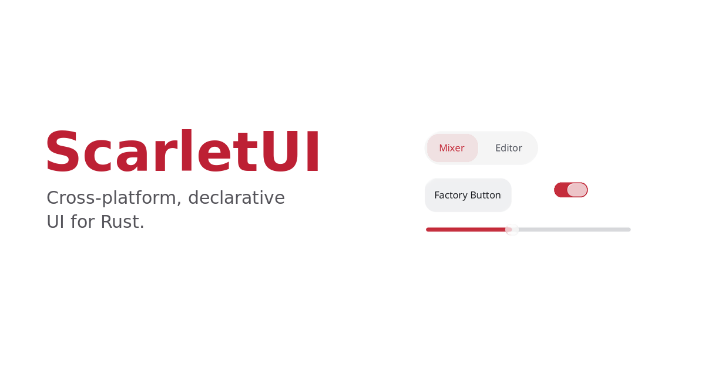

# ScarletUI

ScarletUI is a cross-platform declarative UI framework for Rust applications.

[Official website](https://ui.scarlet-os.org/) · [Getting started](https://ui.scarlet-os.org/getting-started/) · [API reference](https://ui.scarlet-os.org/docs/)

[](https://ui.scarlet-os.org/)

It lets you write UI in a SwiftUI-like style while staying in ordinary Rust:
views are composed with macros and modifiers, state updates are synchronized with
the rendered UI, and view structure is represented by Rust types. That means the
compiler checks your UI code, and editors can still provide Rust-native
completion, navigation, and refactoring.

```rust
use scarlet_ui::prelude::*;
use scarlet_ui::{hstack, vstack};
use scarlet_ui_macros::View;

#[derive(View, Clone)]
#[view(body = content)]
struct CounterApp {
    count: State<i32>,
}

impl CounterApp {
    fn content(&self) -> impl View + Clone + 'static {
        vstack! {
            Text::new("Counter").font_size(24.0),
            Text::new(format!("Count: {}", self.count.get())),
            hstack! {
                Button::new("-").on_click({
                    let count = self.count.clone();
                    move || count.update(|value| *value -= 1)
                }),
                Button::new("+").on_click({
                    let count = self.count.clone();
                    move || count.update(|value| *value += 1)
                }),
            },
        }
        .spacing(12.0)
        .padding(16.0)
    }
}

impl Application for CounterApp {
    fn scenes(&self) -> impl Scene {
        WindowGroup::new("main", Window::new("Counter", self.content()))
    }
}

fn main() -> scarlet_ui::Result<()> {
    let mut app = CounterApp::default();
    app.run()
}
```

Application code declares state, views, and scenes as Rust types. ScarletUI uses
that structure to rebuild, lay out, paint, and present the UI through the
selected platform backend.

## Why ScarletUI

- **Declarative Rust UI**: build interfaces by composing `View` values instead of
  manually updating widgets.
- **State-driven rendering**: `State<T>` drives rebuild, layout, paint, and
  composite, so UI updates follow state changes.
- **Type-safe view structure**: the concrete view tree is built from Rust types,
  so composition errors surface at compile time.
- **IDE-friendly API**: because UI is written as Rust code, normal completion,
  go-to-definition, rename, and diagnostics continue to work.
- **Scene-based applications**: `Application::scenes()` declares top-level
  windows in the same declarative style as views.
- **Cross-platform backend model**: application code does not directly depend on
  SWS, winit, or another windowing backend.

## Get started

Clone this repository and explore the native Widget Factory:

```sh
git clone https://github.com/petitstrawberry/scarlet-ui.git
cd scarlet-ui
cargo run --locked -p scarlet-ui-widget-factory
```

Use a Rust toolchain supporting edition 2024. Native Linux builds also need
`libfontconfig-dev` and `pkg-config`. Follow the [getting started guide](https://ui.scarlet-os.org/getting-started/)
for build requirements, or [try the browser samples](https://ui.scarlet-os.org/try/)
with an available WebGPU adapter.

## Documentation

| Topic | Guide |
| --- | --- |
| <a id="application-model"></a>Application model | [Scenes, windows, layout, and input](docs/APPLICATION_GUIDE.md#application-model) |
| <a id="common-views"></a>Views | [Common views](docs/APPLICATION_GUIDE.md#common-views) and [API reference](https://ui.scarlet-os.org/docs/) |
| <a id="platform-features"></a><a id="sgfx-dependency"></a>Platform features and SGFX | [Build features and dependencies](docs/PLATFORM_GUIDE.md#platform-features) |
| <a id="crate-layout"></a><a id="platform-integration"></a>Backend development | [Crate layout](docs/PLATFORM_GUIDE.md#crate-layout), [platform integration](docs/PLATFORM_GUIDE.md#platform-integration), [architecture](docs/ARCHITECTURE.md), and [1.0 contract](docs/1.0-contract.md) |
| <a id="browser-samples"></a>Browser samples | [Build, run, and current limitations](samples/README.md) |
| <a id="live-preview"></a>Live preview | [Native preview setup and live reload](docs/LIVE_PREVIEW.md) |
| <a id="preview-server-ipc"></a><a id="protocol-v1"></a>Preview server | [Editor integration and Protocol v1](docs/PREVIEW_PROTOCOL.md) |
| <a id="development-commands"></a>Contributing | [Tests and development commands](docs/DEVELOPMENT.md) |

See the [documentation index](docs/README.md) for focused guides and implementation studies.
Documentation is maintained in this repository and imported into the [official site](https://ui.scarlet-os.org/).
