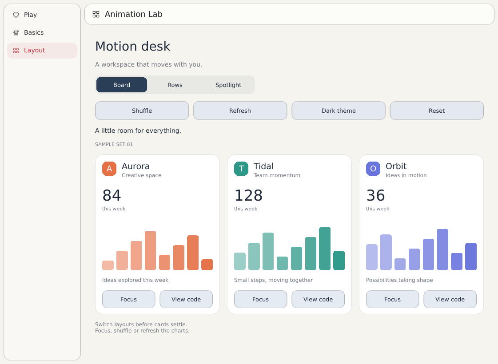

# Animation Lab scroll performance — 2026-11-13

The captured optimized build reduces Play's active-scroll rAF callback CPU p50 by 52% in clean IAB Chromium and 30% in the existing Chrome profile; Basics and Layout have mixed results. Native profiling identifies repeated path tessellation as substantial CPU work, but **native optimized scroll ranges have not been measured**.

The baseline is main `2aa328e8e0a9e68d1e5c027f1be038c0fb0e1ace` **plus the common pre-existing dirty working tree**, including dispatcher and scroll-benchmark changes. The [measurement summary](benchmarks/animation-lab-scroll-2026-11-13.json) records the baseline, common local patch SHA-256, and optimized source/binary hashes. Those pre-existing edits are not included in this PR, so these are development captures rather than measurements of two clean commits. Captures combine geometry, Web frame pacing, and Lab wheel-policy changes without ablation. The later View code relocation, compact-card spacing and initial-width fixes are outside this comparison.

Figures come from the checked-in measurement summary. The original captures, profiler, summarizer and test logs remain in the local `artifacts/web-scroll/2026-11-13/` directory; they are not included in this PR. Summary entries retain their local source filenames and sample windows for traceability. No additional measurement was run while preparing this report.

Browser captures use a 900 × 760 viewport/canvas at DPR 1, ten seconds, and 80 CUA-generated pixel wheel events: 40 at deltaY +152 and 40 at −152, with deltaX zero. Each row is one capture per build; compare within the same browser context. Delivered durations differ. The six-event `baseline-play-1` and `pilot-traces/` runs are excluded; the measurement summary identifies the selected raw trace filenames.

The local `profile.js` wrapper measures wall time around the app's requestAnimationFrame callback. “CPU” includes waits within that callback, excludes work elsewhere, and **does not measure presented latency**, GPU completion, compositing, or scanout. Active samples run from the first delivered wheel through 100 ms after the last; quantiles use sorted index `floor(n × q)`. Arrows mean baseline → optimized.

| Browser | Page | Callback p50 (ms) | Callback p95 (ms) | Active samples | Input span (s) |
| --- | --- | ---: | ---: | ---: | ---: |
| Clean IAB | Play | 15.5 → 7.4 | 17.8 → 8.5 | 415 → 325 | 6.834 → 5.301 |
| Clean IAB | Basics | 0.3 → 0.2 | 2.1 → 1.2 | 244 → 249 | 3.950 → 4.050 |
| Clean IAB | Layout | 0.3 → 0.3 | 3.0 → 3.4 | 243 → 277 | 3.950 → 4.500 |
| Existing Chrome | Play | 16.4 → 11.5 | 23.4 → 18.9 | 370 → 350 | 6.299 → 5.855 |
| Existing Chrome | Basics | 0.5 → 0.7 | 3.9 → 4.7 | 246 → 271 | 4.066 → 4.437 |
| Existing Chrome | Layout | 0.8 → 0.8 | 11.3 → 8.3 | 244 → 243 | 3.950 → 3.953 |

Play's callback p95 falls 52% in IAB and 19% in Chrome. Active callbacks exceeding 16.67 ms fall from 108/415 to 0/325 in IAB and 172/370 to 44/350 in Chrome. The light-case regressions remain relevant: IAB Layout p95 rises 3.0 → 3.4 ms and maximum rises 3.3 → 7.0 ms; Chrome Basics p50/p95 rise, with maximum 5.4 → 7.9 ms. Single captures cannot distinguish noise from a repeatable regression.

These rAF timestamp gaps cover the **whole ten-second capture**, not confirmed presentations. Median intervals remain about 16.7 ms throughout. The raw `over_16_67_ms` interval count is not a dropped-frame count: normal rounded 60 Hz intervals can exceed that threshold.

| Browser | Page | Maximum rAF gap (ms) | Gaps >25 ms | Gaps >50 ms |
| --- | --- | ---: | ---: | ---: |
| Clean IAB | Play | 116.7 → 17.8 | 5 → 0 | 2 → 0 |
| Clean IAB | Basics | 17.7 → 17.7 | 0 → 0 | 0 → 0 |
| Clean IAB | Layout | 17.7 → 17.7 | 0 → 0 | 0 → 0 |
| Existing Chrome | Play | 133.4 → 83.4 | 17 → 10 | 4 → 3 |
| Existing Chrome | Basics | 66.7 → 33.8 | 2 → 1 | 1 → 0 |
| Existing Chrome | Layout | 50.0 → 17.7 | 6 → 0 | 0 → 0 |

Chrome Play still has long gaps, and its whole-capture maximum callback duration increases 66.6 → 86.9 ms despite improved central quantiles. The earlier IAB Play baseline callback p50 of 14.4 ms describes the whole capture; the active-window p50 is 15.5 ms above. Mixing these windows would misstate the comparison.

Native baseline frame logs used DPR 2 and physical content size 2500 × 1288, so they are not directly comparable with browser DPR 1. The measurement summary records the selected byte ranges in the local `baseline-native-frames.log`. `frame_us` measures CPU render/submit wall time with instrumentation enabled, excluding physical scanout.

| Native baseline page | Render samples | Render p50 (ms) | Render p95 (ms) |
| --- | ---: | ---: | ---: |
| Play | 847 | 13.970 | 15.943 |
| Basics | 12 | 1.102 | 12.621 |
| Layout | 41 | 2.510 | 2.755 |

Basics' 12-sample p95 equals its maximum and is not a stable tail estimate. Play has 31/847 render samples above 16.67 ms. **Native optimized numbers are pending:** Native UI automation could not obtain matched after-ranges; the existing optimized executable and launch log do not establish an after result.

The local `baseline-native-play.sample.txt` profile, taken every 1 ms on macOS, contains 7,367 samples in the main execution chain (7,421 for the thread overall), 6,839 under `render_for_present`, 5,335 under `lower_cached_layer`, and 2,587 under `fill_path` in one branch, with `tessellate_even_odd` below it. These inclusive counts overlap and must not be added. They support prioritizing geometry: Animation Lab repeatedly constructs sampled curves, including 48-point circles and Orbit's 40 trail circles.

The bounded implementation addresses three observed behaviors:

- Geometry validates all coordinates and rejects paths outside partial render areas or explicit clips before tessellation, with a one-device-pixel margin. Unclipped full-frame recordings retain offscreen geometry for later translation; the regression fails without this guard and passes with it.
- Tessellation sweeps overlapping Y intervals and maintains active band edges. The 48-edge circle test reduces intersection candidates **1,128 → 35**, a work count rather than a frame-time speedup. Reference comparisons preserve even-odd/self-intersection behavior and ordering. Heavily overlapping contours can still require quadratic work. No general cache, lowering change, or SGFX dependency change was introduced.
- Web frame pacing grants each request once at a real rAF while preserving synchronous input/order and pause/resume behavior. Lab vertical pages relax the axis policy that rejected diagonal wheel input; the saved baseline regression log records a dropped `(4, −8)` sample. Timed traces have deltaX zero, so this input fix is validated separately.

| Validation | Recorded status |
| --- | --- |
| Renderer unit tests | **148 passed** after the final retention guard; includes reference comparisons across scales, translations, clips, holes, coincident edges, and self-intersections. |
| Renderer GPU correctness | **8 passed**, GPU required, on Apple M3 Pro / Metal: filled edges, clipping, translated retained meshes, scroll tiles, partial repaint, and nested caches. Local log: `renderer-gpu-tests.log`. |
| Web frame/input tests | **5 host tests passed**; **20 browser tests passed**. Local browser log: `scarlet-web-frame-browser-test.log`. |
| Animation Lab | **14 passed** after the final UI fixes. Local log: `final-lab-tests.log`. |

Remaining validation is matched native after-ranges, repeat browser trials for the noisy light cases, and physical trackpad/high-refresh presentation measurements. No physical trackpad gesture or 120 Hz display run was validated. Synthetic 120 Hz frame-pacing tests verify state transitions, not real 120 Hz rendering or latency. The captured browser cadence is approximately 60 Hz.

The same change set also moves View code next to Focus on each Layout card, keeps Chart/Layout/Theme walkthrough navigation, avoids text/button overlap in compact cards, and preserves the page width measured inside navigation at startup. Native and Web release builds succeeded; the Web UI was checked in Board, Rows, Spotlight and narrow layouts.

